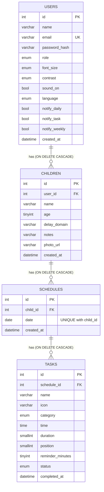

# Entity-relationship diagram

> Matches `backend/database/schema.sql` (checked column by column). Export a PNG from this Mermaid source
> for the technical document and the paper (GitHub renders the block below directly).

## Design notes

- **Normalization (3NF).** Every table has a single-column primary key and every non-key column depends only on that key.
  Children belong to one user, schedules to one child, tasks to one schedule, so nothing is repeated across rows.
  The seven preference columns sit on `users` because each user has exactly one set of preferences (a separate table
  would be a 1:1 join with no benefit).
- **Why `position` is stored.** Two tasks can share a start time, and an adult can drag a task above an earlier one
  without changing its time. A stored `position` keeps the order the adult chose; `time` is only displayed.
- **One schedule per child per date.** `UNIQUE (child_id, date)` gives the API a clean 409 and means "today's routine" is
  at most one row.
- **Deleting is a cascade.** Removing a user, child or schedule removes everything below it (`ON DELETE CASCADE`).
- **Completion is checked in the database.** `status = 'completed'` requires `completed_at`, and `pending` forbids it
  (`ck_tasks_completed`). The model and the API keep the same rule, so the three layers agree.
- **Progress is derived, not stored.** Completion rates are computed from the task rows on request; no counter can drift.
